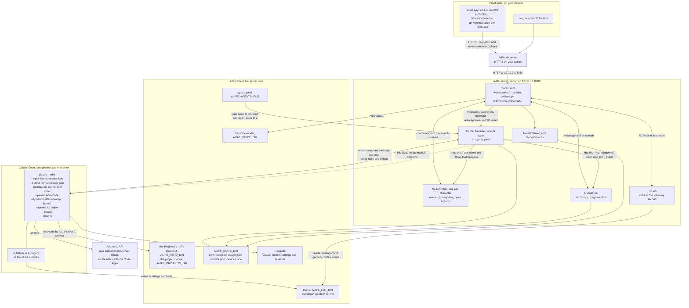
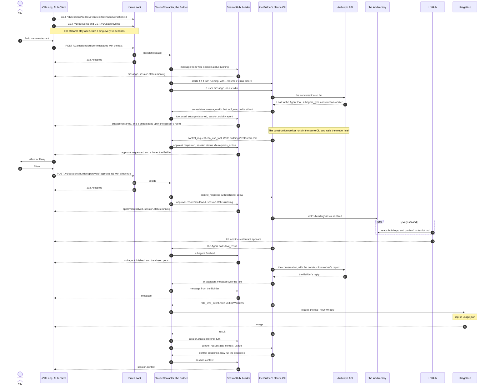
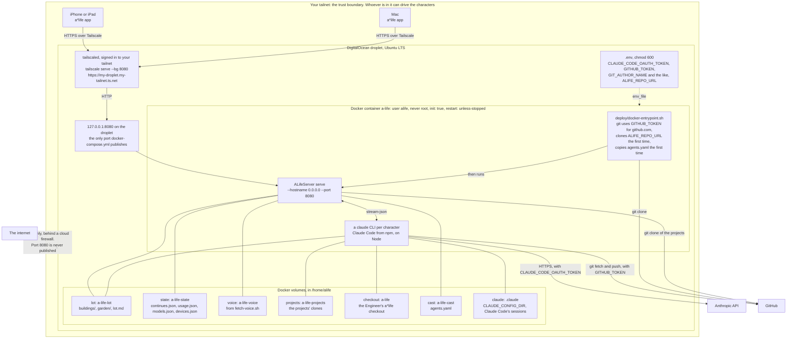
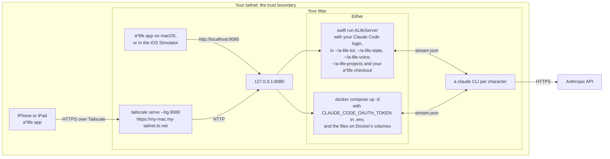

# a-life-server

The backend the a*life front ends talk to. It is a [Vapor](https://vapor.codes) server meant to run on your own Mac, or on a Linux server of your own (see [Run it on a server](#run-it-on-a-server)), and be reached over [Tailscale](https://tailscale.com).

It holds one session per character on the lot. **Each character is a Claude Code session of its own**, run by the Claude Code installed where the server runs: its conversation, what it is doing, the helpers (subagents) it has sent off, and any tool call it is waiting on you to allow. Front ends follow every session over a stream of events, and talk to each character directly. No character coordinates the others; that's up to you.

The characters work on a *lot*: a directory they share, `~/a-life-lot` unless you say otherwise. The Builder's buildings and the Conservationist's beds are Markdown files in it, and the server sends the front ends what stands where, so a restaurant the Builder builds appears on the lot in the app. See [The lot](#the-lot). The Engineer works on a\*life itself instead, in your a\*life checkout. See [The characters](#the-characters).

If you'd rather not spend tokens, the server can also run dummy characters that play a short script. See [The dummy characters](#the-dummy-characters).

## Architecture

### Who talks to whom

The front ends never talk to Claude themselves. They talk to the server, over HTTPS on your tailnet, and the server runs one Claude Code CLI per character, which talks to the Anthropic API on your Claude subscription. Everything a character does comes back to the front ends as events on its session's stream.



- **The front ends** use `ALifeClient`: a `ServerConnection` reads `GET /v1/sessions` to learn who is on the lot, opens one event stream per session, and follows `/v1/lot/events` and `/v1/usage/events` too. Each character is an `AgentSession`, which sends what you say and your answers as plain HTTP requests. See [The API](#the-api).
- **The server** keeps a `SessionHub` per character, which holds its events and sends them to every stream that's open, and a backend per character that plays it: `ClaudeCharacter`, or the [dummies](#the-dummy-characters). See [How it fits together](#how-it-fits-together).
- **Each character** is a `claude` process of its own, started with the first thing you say to it, in the directory it works in, and kept running between turns. Its helper is a subagent in that same process, defined with `--agents`. When a CLI has stopped, the next thing you say starts it again with `--resume`, in the same Claude Code session. See [The characters](#the-characters).
- **The files** are all where the server runs: the lot the characters build and plant on, which `LotHub` reads every second; the checkouts and clones they work in; what the server remembers between starts; the agents file; the voice model; and Claude Code's own sessions.

### One round trip

Here you tell the Builder to build a restaurant. It sends its construction worker off, which asks before it writes the building, you allow it, and the restaurant appears on the lot. Every arrow back to the app is an event on one of the streams it follows.



Claude Code writes a `rate_limit_event` whenever what it knows about the limits changes, which is on every turn, so the usage can arrive at any point in a turn, not only at the end. With auto approve on, nobody is asked: the server answers `can_use_tool` itself, straight after `approval.requested`, so steps 19 to 23 don't happen, the session stays `running`, and the approval is resolved as `auto_approved`. The table in [The characters](#the-characters) has the rest of how Claude Code's messages become events.

### On a droplet

This is the setup in [Run it on a server](#run-it-on-a-server): a DigitalOcean droplet, with the server in a Docker container, shared with your tailnet by `tailscale serve`. The container publishes its port on the droplet's `127.0.0.1` only, so nothing reaches the server but what comes in through Tailscale.



- **The trust boundary is your tailnet.** The server has no login: any device that can reach `https://my-droplet.my-tailnet.ts.net` can tell the characters what to do and answer their approvals, and so run commands in the container, on your subscription and with your GitHub token. That's why the port is published on `127.0.0.1` only, and why it is `tailscale serve` and never `tailscale funnel`. See [Keep it to yourself](#keep-it-to-yourself).
- **Inside the container** the server listens on `0.0.0.0`, which only Docker's port mapping can reach. `init: true` reaps whatever the characters' Claude Code sessions leave behind.
- **Going out**, the droplet only talks to the Anthropic API, for the characters' calls to the model, and to GitHub, for the Engineer's checkout and the projects' clones, and whatever else the characters fetch or push.
- **What matters is on the volumes**, so a new image keeps it. See [What it keeps, and where](#what-it-keeps-and-where).

[Without Docker](#without-docker) it is the same picture without the container: the server runs under systemd as the user `alife`, on `127.0.0.1:8080`, with its settings in `/home/alife/a-life.env` and its files in `alife`'s home.

### On your Mac

On your own Mac, the server runs natively with `swift run ALifeServer`, on your Claude Code login, or in Docker with the same `docker-compose.yml` and a `.env` with your token. The app on the same Mac, or the iOS Simulator, uses `http://localhost:8080` without Tailscale; your other devices come in through `tailscale serve`, as they would to a droplet.



Natively, the Engineer works in the checkout you ran `swift run` in, and the Team Lead adds agents to its `agents.yaml`; in Docker, both are on the container's volumes, as on a droplet. Either way the server listens on `127.0.0.1`, which only this Mac can reach, until `tailscale serve` shares it with your tailnet. See [Make it reachable over Tailscale](#make-it-reachable-over-tailscale).

## Run it

You need Swift 6 (Xcode 16 or later) on macOS 14 or later, or Swift 6 on Linux, and [Claude Code](https://code.claude.com) installed and logged in: `claude` in a terminal should start a session. The characters use that login and its settings, each on the model the [agents file](#the-agents-file) gives it (which the app's model picker can change), and what they do counts towards your usage like any other Claude Code session.

```sh
cd a-life-server
swift run ALifeServer
```

The server finds the `claude` command on your `PATH`, or where its installer puts it, and says which one it uses and where the lot is when it starts. It starts a character's session with the first thing you say to it.

The server listens on `http://127.0.0.1:8080`, which only this Mac can reach. Check it:

```sh
curl http://127.0.0.1:8080/health
# {"status":"ok"}
```

To use another port: `swift run ALifeServer serve --port 9000`.

### Try it without a front end

See who is on the lot:

```sh
curl http://127.0.0.1:8080/v1/sessions
```

In one terminal, follow the Builder's session:

```sh
curl -N http://127.0.0.1:8080/v1/sessions/builder/events
```

In another, tell the Builder what to do, then answer the approval it asks for:

```sh
curl -X POST http://127.0.0.1:8080/v1/sessions/builder/messages \
  -H 'Content-Type: application/json' -d '{"text":"Build me an office"}'

# the Builder sends its construction worker off (subagent.started), which
# asks before it writes buildings/office.md; look up the approval's id ...
curl http://127.0.0.1:8080/v1/sessions/builder

# ... and allow it
curl -X POST http://127.0.0.1:8080/v1/sessions/builder/approvals/<id> \
  -H 'Content-Type: application/json' -d '{"allow":true}'
```

The Conservationist's session is at `/v1/sessions/conservationist`, and carries on independently. Ask it to plant something or put out animals and it sends its keeper off.

See what stands on the lot, and follow it as it changes:

```sh
curl http://127.0.0.1:8080/v1/lot
curl -N http://127.0.0.1:8080/v1/lot/events
```

### Settings

All optional, as environment variables:

| Variable | What it does |
|---|---|
| `ALIFE_LOT_DIR` | The directory the characters work in, and whose buildings and beds the front ends show. `~/a-life-lot` unless set; it is made if it isn't there. The dummy characters don't change it, but the front ends still show what's on it. |
| `ALIFE_REPO_DIR` | The a\*life checkout the Engineer works in. The checkout the server was built from unless set. See [The Engineer and the a\*life checkout](#the-engineer-and-the-alife-checkout). |
| `ALIFE_CLAUDE_PATH` | The `claude` command, if the server doesn't find it by itself on the `PATH`, in `~/.local/bin`, `/opt/homebrew/bin`, `/usr/local/bin`, `/usr/bin` or npm's global `bin`. |
| `ALIFE_BACKEND` | `claude` (the default), or `dummy` for the scripted dummies. |
| `ALIFE_AGENTS_FILE` | The agents file, which lists the characters, and which the Team Lead adds agents to. Set it to a file of your own, such as `~/.config/a-life/agents.yaml`, to keep your own cast outside the checkout. Unless set, [`Sources/ALifeServer/agents.yaml`](Sources/ALifeServer/agents.yaml) in the checkout the server was built from, or the copy the server ships with if that checkout is gone. See [The agents file](#the-agents-file). |
| `ALIFE_VOICE_DIR` | The voice model the server offers the front ends, for the characters to speak with. `~/a-life-voice` unless set. See [Voices](#voices). |
| `ALIFE_STATE_DIR` | Where the server keeps what it remembers between starts: the characters waiting for the usage limit to reset, in `continues.json`, the last usage reading, in `usage.json`, the models chosen in the app, in `models.json`, and the devices registered for notifications, with the server's own id, in `devices.json`. `~/a-life-state` unless set; it is made when there is something to keep. See [The usage limit](#the-usage-limit). |
| `ALIFE_PROJECTS_DIR` | Where the server clones the projects that are git repositories, one directory per character, named after its id (with a clone of each repository in it, for a project of several). `~/a-life-projects` unless set. See [A character for another project](#a-character-for-another-project). |
| `ALIFE_APNS_KEY_FILE` | The `.p8` key file from your Apple developer account, for sending push notifications. See [Push notifications](#push-notifications). |
| `ALIFE_APNS_KEY_ID` | That key's id, ten characters. |
| `ALIFE_APNS_TEAM_ID` | Your Apple developer team's id. |
| `ALIFE_APNS_TOPIC` | The app's bundle id, `com.q231950.alife` unless you build it under your own. Devices registering for another app are refused. |

```sh
ALIFE_LOT_DIR=~/Desktop/lot swift run ALifeServer
```

There's no setting for the model: each character has its own, in the agents file (`model`), and the app's model picker can change it. `ALIFE_CLAUDE_MODEL`, which chose one model for every character, isn't read any more; the server says so if it is still set.

## Make it reachable over Tailscale

The front ends on your other devices reach the server through your tailnet. `tailscale serve` puts an HTTPS address in front of the local port, so the server itself can keep listening on `127.0.0.1` only.

1. Install Tailscale on this Mac and on each device that runs a front end, and sign them in to the same tailnet.
2. In the Tailscale admin console, on the DNS page, turn on **MagicDNS** and **HTTPS Certificates**. `tailscale serve` needs both.
3. Start the server (`swift run ALifeServer`).
4. Share the port with the tailnet:

   ```sh
   tailscale serve --bg 8080
   ```

   It prints the address, which looks like `https://my-mac.my-tailnet.ts.net`. `--bg` keeps it running after the terminal closes and across restarts.
5. From another device on the tailnet, check it: open `https://my-mac.my-tailnet.ts.net/health`.
6. In the app, open the settings (the gear at the top), enter that address and press **Connect**.

Useful afterwards:

```sh
tailscale serve status   # what is being shared
tailscale serve reset    # stop sharing
```

Notes:

- If the `tailscale` command isn't found, the Mac app ships it at `/Applications/Tailscale.app/Contents/MacOS/Tailscale`; the app's settings can also install the command for you.
- These commands are for current Tailscale versions. If yours differs, `tailscale serve --help` shows the syntax.
- **There is no login on this server.** Anyone who can reach the address can instruct the characters and answer their approvals, and the characters are Claude Code sessions on your Mac, using your login: whoever can reach the server can have them run commands there. With `tailscale serve` that means the devices in your tailnet, subject to its access rules. Don't use `tailscale funnel` for it: that publishes the address to the whole internet.

### Without HTTPS

If you can't turn on HTTPS certificates, the server can listen on the Mac's Tailscale address directly:

```sh
tailscale ip -4                                              # e.g. 100.101.102.103
swift run ALifeServer serve --hostname 100.101.102.103 --port 8080
```

Then use `http://100.101.102.103:8080` in the app. The app allows plain HTTP to IP addresses and local names for this purpose. Traffic inside a tailnet is encrypted by Tailscale either way.

### On the same Mac

The macOS app and the iOS simulator can use `http://localhost:8080` with no Tailscale involved. The settings have a button for it.

## Run it on a server

The server can run on a Linux server of your own rather than on your Mac, so that the characters carry on while your Mac is asleep or away. It is the same server, reached the same way, over your tailnet. These steps use a [DigitalOcean](https://www.digitalocean.com) droplet with Ubuntu LTS and Docker, but any Linux machine you can install Docker and Tailscale on will do. If you'd rather not use Docker, see [Without Docker](#without-docker).

**One person, one server.** a\*life isn't a shared service. Everyone who uses it runs their own server, on their own tailnet, with their own Claude subscription. The server has no accounts and no login: whoever can reach it is you, as far as it knows. Read [Keep it to yourself](#keep-it-to-yourself) before you start.

### 1. Make a droplet

In DigitalOcean, create a droplet:

- **Image**: Ubuntu, the latest LTS (24.04 at the time of writing).
- **Size**: about 4 GB of memory. Each character's session is a Claude Code process of its own, which keeps running between turns, so several characters at once need room; building the server needs some too.
- **Authentication**: your SSH key.

Log in to it, and add some swap, so that building the server doesn't run out of memory:

```sh
ssh root@<the droplet's address>
fallocate -l 4G /swapfile && chmod 600 /swapfile && mkswap /swapfile && swapon /swapfile
echo '/swapfile none swap sw 0 0' >> /etc/fstab
```

Nothing on the droplet needs to be reachable from the internet but SSH. A DigitalOcean cloud firewall that lets in SSH and nothing else is a good idea; the server's port is never published there anyway (see below).

### 2. Install Docker and Tailscale

```sh
curl -fsSL https://get.docker.com | sh
curl -fsSL https://tailscale.com/install.sh | sh
tailscale up
```

`tailscale up` prints a link: open it and sign the droplet in to your tailnet, the same one as the devices you run the app on. In the Tailscale admin console, on the DNS page, turn on **MagicDNS** and **HTTPS Certificates**, if you haven't already for your Mac.

### 3. Get your Claude token

The characters run on your Claude Pro or Max subscription. On your own computer, where Claude Code is installed and logged in, run:

```sh
claude setup-token
```

It has you log in in the browser and prints a long-lived token, starting `sk-ant-oat`. That token is your subscription: keep it secret, and don't put it anywhere but the server's `.env` below.

### 4. Get a\*life and fill in `.env`

On the droplet:

```sh
git clone https://github.com/q231950/a-life.git
cd a-life/a-life-server
cp .env.example .env
chmod 600 .env
nano .env
```

Put your token after `CLAUDE_CODE_OAUTH_TOKEN=`. The other settings in [`.env.example`](.env.example) are optional: a GitHub token for the characters who work on repositories (see [Git on the server](#git-on-the-server)), who they commit as, and the a\*life repository the Engineer works on. `.env` stays on the droplet: git leaves it out.

### 5. Start it

```sh
docker compose up -d
docker compose logs -f
```

The first start builds the server's image, which takes a while: it builds the server with Swift, then puts it, Node, [Claude Code](https://www.npmjs.com/package/@anthropic-ai/claude-code) and git into a small image to run in. Once it's up, the log says who is on the lot and where each character works; press Ctrl-C to stop following it. Check it:

```sh
curl http://127.0.0.1:8080/health
# {"status":"ok"}
```

It starts again by itself after a reboot, or if it stops.

### 6. Fetch the voice model

For the characters to speak (see [Voices](#voices)), fetch the voice model into the server's voice volume, and restart it:

```sh
docker compose exec a-life fetch-voice.sh
docker compose restart
```

### 7. Share it with your tailnet

```sh
tailscale serve --bg 8080
```

It prints the address, which looks like `https://my-droplet.my-tailnet.ts.net`. From a device on your tailnet, open `https://my-droplet.my-tailnet.ts.net/health` to check it. Then, in the app, open the settings (the gear at the top), enter that address and press **Connect**.

### What it keeps, and where

The server runs as the user `alife` in its container, never root, and keeps everything that matters on Docker volumes, so that it outlasts a new image:

| Volume | In the container | What's in it |
|---|---|---|
| `lot` | `/home/alife/a-life-lot` | The lot: what the characters build and plant. |
| `state` | `/home/alife/a-life-state` | Who is waiting for the usage limit, the last usage reading, the models chosen in the app, and the devices registered for notifications. |
| `voice` | `/home/alife/a-life-voice` | The voice model. |
| `projects` | `/home/alife/a-life-projects` | The clones of the projects the characters work on. |
| `checkout` | `/home/alife/a-life` | The Engineer's a\*life checkout. |
| `cast` | `/home/alife/a-life-cast` | The agents file. |
| `claude` | `/home/alife/.claude` | Claude Code's settings and sessions (`CLAUDE_CONFIG_DIR`), so that a character waiting for the usage limit can resume its session after a restart, and `claude --resume` in the container finds the characters' conversations. |

**The agents file** is copied from the one the server ships with the first time it starts, into the `cast` volume, and is yours from then on: the Team Lead adds agents to it, and a new image doesn't change it. To edit it, take a copy out, change it, and put it back:

```sh
docker compose exec a-life cat /home/alife/a-life-cast/agents.yaml > agents.yaml
nano agents.yaml
docker compose exec -T a-life sh -c 'cat > /home/alife/a-life-cast/agents.yaml' < agents.yaml
docker compose restart
```

To use a cast of your own instead, such as the one you keep on your Mac in `~/.config/a-life/agents.yaml`, copy it to the droplet and put it in the volume the same way, with the last two lines. (The image already sets `ALIFE_AGENTS_FILE` to the file in the volume, so there is nothing to add to `.env`.) The shipped cast only has characters that work for anyone; add your own with the Team Lead, or by editing the file, with projects of your own (see [A character for another project](#a-character-for-another-project)). Their repositories are cloned with `GITHUB_TOKEN`, so give it access to each of them.

### Git on the server

The characters who work on repositories clone, fetch and push with git on the server, which has none of your Mac's keys. Give it access to only the repositories they work on:

- **A fine-grained GitHub token** is the simplest. On GitHub, under Settings, Developer settings, Personal access tokens, Fine-grained tokens, make one with access to only those repositories, and **Contents: Read and write** (Read is enough if they never push). Put it in `.env` as `GITHUB_TOKEN`. The container then has git use it for every GitHub address, the ssh ones in the agents file (`git@github.com:you/my-app.git`) as well as https ones, without writing it to a file. The characters' sessions can use it too, which is the point: keep its access to what they need.
- **A deploy key** works as well, for a single repository: an SSH key made on the server, added to the repository under Settings, Deploy keys (with write access if they push). A deploy key only opens one repository, so for several, use the token. With Docker, the key has to be in the container user's `~/.ssh`; the token is easier.

To have them commit as you, set `GIT_AUTHOR_NAME`, `GIT_AUTHOR_EMAIL`, `GIT_COMMITTER_NAME` and `GIT_COMMITTER_EMAIL` in `.env`.

**The Engineer** works on a\*life in the server's own a\*life checkout, since your Mac's isn't there. The container clones it the first time it starts, from `ALIFE_REPO_URL` (the a\*life repository on GitHub unless you set it) into the `checkout` volume (`ALIFE_REPO_DIR`), and uses it as it is after that. To have the Engineer push its work, point `ALIFE_REPO_URL` at your own fork, and give your GitHub token access to it. To start afresh, remove the volume (`docker compose down`, then `docker volume rm a-life-server_checkout`) and start it again. The image has no Swift in it, so the Engineer's a\*life expert can change the code there but can't build it or run its tests; [Without Docker](#without-docker), with Swift installed, it can.

### Updating

```sh
cd ~/a-life
git pull
cd a-life-server
docker compose up -d --build
```

That builds the server again from the new code and starts it, keeping the volumes. The Claude Code in the image is the one that was newest when the image was built, and doesn't update itself; to fetch a newer one, build it from scratch with `docker compose build --no-cache` and then `docker compose up -d`. Your agents file and the Engineer's checkout aren't changed by an update.

### Backups

What you'd miss is on the volumes, above all `lot`, `cast` and `state`, and the clones in `projects` with work you haven't pushed. To back them all up into the current directory, stop the server for a moment and pack each one:

```sh
docker compose stop
for volume in lot state voice projects checkout cast claude; do
  docker run --rm -v "a-life-server_$volume:/data:ro" -v "$PWD:/backup" debian:bookworm-slim \
    tar czf "/backup/a-life-$volume.tar.gz" -C /data .
done
docker compose start
```

Copy the archives somewhere off the droplet. `claude` has the characters' conversations in it, so keep the backups as private as the server. DigitalOcean's own droplet backups cover the volumes too. To restore one, unpack it into the volume the same way, with `tar xzf` in place of `tar czf`.

### Keep it to yourself

- **There is no login.** Anyone who can reach the server can tell the characters what to do and answer their approvals, so they can have it run commands on the droplet, with your Claude subscription, and your GitHub token if it has one.
- **Keep it on your tailnet.** `docker-compose.yml` publishes the server's port on the droplet's `127.0.0.1` only, so nothing outside the droplet reaches it but through `tailscale serve`. Don't change that to `8080:8080` or `0.0.0.0`: Docker opens a published port to the internet, past `ufw`. And never use `tailscale funnel` for it: that publishes it to the whole internet. If others share your tailnet, Tailscale's access rules can keep them away from the droplet.
- **Your token is yours alone.** The server runs on your Claude subscription, so don't share your instance or your token with anyone; let them run a server of their own. Keep `.env` readable only by you (`chmod 600 .env`), and if the token gets out, revoke it in your Claude account and make a new one.

### Without Docker

The server also runs straight on the droplet, under systemd, as a user of its own. Then it is much as on a Mac: the Engineer works in the checkout the server was built from, and the agents file is that checkout's, unless you set `ALIFE_AGENTS_FILE` in `/home/alife/a-life.env` to a file of your own, such as `/home/alife/.config/a-life/agents.yaml`.

1. Make the user, and install git, Node 18 or later, and Claude Code:

   ```sh
   adduser --disabled-password --gecos '' alife
   apt-get install -y git curl unzip nodejs npm
   npm install -g @anthropic-ai/claude-code
   ```

2. Install Swift 6 for the user `alife`, as [swift.org](https://www.swift.org/install/linux/) describes.

3. As `alife` (`su - alife`), get a\*life, build the server and fetch the voice model:

   ```sh
   git clone https://github.com/q231950/a-life.git ~/a-life
   swift build --package-path ~/a-life/a-life-server -c release --static-swift-stdlib
   ~/a-life/a-life-server/fetch-voice.sh
   ```

   `--static-swift-stdlib` builds the Swift runtime into the server, so it doesn't depend on the Swift you built it with staying where it is.

4. Put the settings in `/home/alife/a-life.env`, as in [`.env.example`](.env.example), with at least `CLAUDE_CODE_OAUTH_TOKEN`, and keep it to `alife`: `chmod 600 /home/alife/a-life.env`. The lot, the state, the voice model and the projects go in `alife`'s home, as on a Mac (see [Settings](#settings)).

5. As root, install [`deploy/a-life-server.service`](deploy/a-life-server.service), which runs the server as `alife`, listening on `127.0.0.1:8080` only, and start it:

   ```sh
   cp /home/alife/a-life/a-life-server/deploy/a-life-server.service /etc/systemd/system/
   systemctl daemon-reload
   systemctl enable --now a-life-server
   journalctl -u a-life-server -f
   ```

6. Share it with `tailscale serve --bg 8080`, as above.

`GITHUB_TOKEN` only does anything in the container. Without Docker, give `alife` its own git access: an SSH key (`ssh-keygen` as `alife`) added as a deploy key to a repository, or for several, the fine-grained token through git's credential store:

```sh
git config --global credential.helper store
printf 'https://x-access-token:%s@github.com\n' '<your token>' > ~/.git-credentials
chmod 600 ~/.git-credentials
git config --global url."https://github.com/".insteadOf git@github.com:
```

To update, `git pull` in `~/a-life`, build it again, and `systemctl restart a-life-server`.

## The API

All bodies are JSON. The types are defined once, in the `ALifeAPI` module of [`../ALifeKit`](../ALifeKit), and used by both the server and the clients.

A session's `{id}` is its character's, such as `builder` or `engineer`, and never changes.

| Method | Path | Body | What it does |
|---|---|---|---|
| `GET` | `/health` | | `{"status":"ok"}` |
| `GET` | `/v1/sessions` | | Every session as it is right now, one per character: id, name, colour (`#RRGGBB`, the character's shirt), status, what it is doing, messages, pending approvals, the whole conversation (`conversation`, see below), helpers out, whether auto approve is on (`auto_approve`), how full the character's Claude Code session is and the model playing it (`context`, see `session.context` below; left out until its session has said), the model it runs on (`model`, see `session.model` below) and the one the agents file gives it (`file_model`), each left out for Claude Code's own default, last sequence number. |
| `GET` | `/v1/sessions/{id}` | | One session as it is right now. |
| `GET` | `/v1/sessions/{id}/events` | | The session's event stream (server-sent events). See below. |
| `POST` | `/v1/sessions/{id}/messages` | `{"text": "…"}` | Says something to the character. Works while it is busy: it answers at its next step. `409` while it waits for an approval. |
| `POST` | `/v1/sessions/{id}/interrupt` | | Stops whatever the character is doing, and withdraws a pending approval. |
| `POST` | `/v1/sessions/{id}/approvals/{approval id}` | `{"allow": true}` | Answers a tool call that is waiting. `404` if there is no such approval. |
| `PUT` | `/v1/sessions/{id}/auto-approve` | `{"enabled": true}` | Turns auto approve on or off for this character only. While it's on, each tool call that asks is allowed straight away, and still shows in the conversation, settled as `auto_approved`. Turning it on allows whatever is waiting, too. It stays as it is when the session is started over, and is off when the server starts. |
| `PUT` | `/v1/sessions/{id}/model` | `{"model": "opus"}` | Changes the model the character runs on, for every front end: `fable`, `opus`, `sonnet` or `haiku`, or `null` to go back to the agents file's. While its Claude Code runs, it switches at once (`set_model`), from its next call to the model, even mid-turn and while it waits for you; otherwise it starts on it next time. It stays across starting over, and across a restart of the server, in `models.json`, until the agents file gives the character another model. `400` for any other name. See [The model](#the-model). |
| `GET` | `/v1/models` | | The models a character can be switched to, strongest first: `model`, and, once Claude Code has said, `name` with the version it stands for (`"Opus 5.5"`), `description` and `resolved` (`claude-opus-5-5`). |
| `POST` | `/v1/sessions/{id}/reset` | | Ends the session's conversation and starts an empty one, for every front end. The other sessions carry on. |
| `GET` | `/v1/lot` | | Everything built and planted on the lot. See [below](#the-lot-and-its-stream). |
| `GET` | `/v1/lot/events` | | The lot's stream (server-sent events): the lot as it is now, then again each time it changes. |
| `GET` | `/v1/usage` | | How much of Claude's 5-hour usage window is used, as the server last heard. See [below](#the-usage-and-its-stream). |
| `GET` | `/v1/usage/events` | | The usage's stream (server-sent events): the usage as it is now, then again each time it changes. |
| `GET` | `/v1/voice/{path}` | | The voice model's files, as they are in `ALIFE_VOICE_DIR`: `bundle.json`, then each file it lists. `404` for anything else, and for everything if there's no model. See [Voices](#voices). |
| `PUT` | `/v1/devices/{token}` | `{"environment": "sandbox", "bundle_id": "com.q231950.alife", "name": "iPhone"}` | Registers a device for push notifications by its APNs token, in hex, or registers it again, which says it was seen: the app does it on every launch. `environment` is `sandbox` or `production`, the one its token belongs to, and `name` is only for the log. Answers `{"server_id": "…", "push_enabled": true}`: the server's own id, which its notifications carry, and whether it is set up to send. A device is taken while it isn't, so it hears once it is. `400` for a token that isn't hex, another environment, or a bundle id other than `ALIFE_APNS_TOPIC`. See [Push notifications](#push-notifications). |
| `DELETE` | `/v1/devices/{token}` | | Forgets the device. `204`, also if it wasn't registered. |
| `POST` | `/v1/devices/{token}/test` | | Sends the device a test notification, "a*life can reach you.", for the app's Send a test and for trying it with curl. `204` once Apple has taken it, `404` for a device that isn't registered, `410` if Apple says its token is gone (it is forgotten), `502` if Apple turned it away for another reason, and `503` if the server isn't set up to send. |

An unknown session id gets a `404`. The `POST` and `PUT` routes on sessions answer `202 Accepted` as soon as the request is taken; what happens next arrives on the event stream. Errors look like `{"error": true, "reason": "…"}`.

### The event stream

`GET /v1/sessions/{id}/events` stays open and sends one event per thing that happens in that session:

```
id: 4
event: session.activity
data: {"seq":4,"event":{"type":"session.activity","activity":"read"},"time":1795000000.25}
```

Every event has a sequence number that only goes up within its session. Its `time` is when it happened, by the server's clock, in seconds since 1970, so a front end catching up on what it missed can say when; servers from before it leave it out. A client applies events in order to build its picture of the session, and remembers the last number it saw. When it reconnects it passes that number and the conversation's id:

```
GET /v1/sessions/builder/events?after=4&conversation=<conversation id>
```

The server then sends everything after 4 and carries on live, so nothing is missed or repeated. If the conversation id isn't the current one (the session was started over, or the server restarted), or none is given, the server sends the current conversation from its start. A comment line (`: ping`) goes out every 15 seconds to keep the connection open.

A front end follows every session at once: it reads `GET /v1/sessions` to learn who is on the lot, then opens one stream per session.

| Event | Carries | Meaning |
|---|---|---|
| `conversation.started` | `conversation_id` | A new conversation began in the session. Drop everything known about the old one. |
| `session.status` | `status`, `stop_reason`, `resumes_at` | The character is `running` or `idle`. When idle, `stop_reason` is `end_turn`, `requires_action` (an approval is waiting), `interrupted`, or `usage_limit`: it ran into the 5-hour usage limit and carries on by itself at `resumes_at` (seconds since 1970), which only that one has. See [The usage limit](#the-usage-limit). |
| `session.activity` | `activity` | What the character is doing right now, such as the tool it is using. Absent when it isn't doing anything in particular. |
| `message` | `message` | A line of the conversation: `id`, `kind` (`user`, `agent`, `error`), `speaker`, `text`. Everything the character says is one, along the way as well as at the end. |
| `tool.used` | `tool_use` | The character used a tool, so you can follow along: `id`, `tool_name`, `input` (a few words of what it does, such as a command or a file's path). Its helpers' tools aren't sent. |
| `approval.requested` | `approval` | A tool call needs a yes or no: `id`, `tool_name`, `input`, and `tool_use_id`, the call it asks about. |
| `approval.resolved` | `approval_id`, `outcome` | It was settled. `outcome` is `allowed` or `denied` when you answered, `auto_approved` when auto approve allowed it, and `withdrawn` when it no longer needed an answer, such as after Stop or Start over. Older servers leave `outcome` out. |
| `subagent.started` | `subagent` | The character sent a helper (a subagent) off to do part of its work: `id`, `task`. |
| `subagent.finished` | `subagent_id` | The helper reported back to the character, or was called back because the character was stopped or started over. |
| `session.auto_approve` | `auto_approve` | Auto approve was turned on (`true`) or off for the session. A new conversation starts with it off, so a server that keeps it on sends this again straight after `conversation.started`. |
| `session.model` | `model` | The model the character runs on changed: `fable`, `opus`, `sonnet` or `haiku`, or `null` for Claude Code's own default. It stays across `conversation.started`. See [The model](#the-model). |
| `session.context` | `context` | How full the character's Claude Code session is, and the model playing it: `model`, `used_tokens` (what its context holds as of its last call; its helpers' don't count), `compacts_at` (the tokens at which Claude Code compacts the conversation by itself), `context_window`, and `auto_compact` (whether it does). Each is left out until it is known. A new conversation starts without one. See [How full a session is](#how-full-a-session-is). |

Clients skip event types they don't know, so new ones can be added.

A session's `conversation` is the whole conversation so far, oldest first, built from these events: each entry has a `type` of `message` (with `message`), `tool_use` (with `tool_use`) or `approval` (with `approval`, and `outcome` once it was settled). An approval takes the place of the `tool_use` with its `tool_use_id`, so a call that asks first is in the conversation once. Answered approvals stay in it; `approvals` lists only the ones still waiting. Clients skip entries they don't know, and make a conversation from `messages` and `approvals` if a server from before it doesn't send one.

### The lot and its stream

`GET /v1/lot` answers with everything built and planted:

```json
{
  "revision": 3,
  "items": [
    {"id": "buildings/restaurant.md", "category": "building", "kind": "restaurant", "name": "Luigi's",
     "x": 38, "y": 22, "width": 5, "depth": 4},
    {"id": "garden/roses.md", "category": "plant", "kind": "rose", "name": "Rose bed",
     "x": 20, "y": 30, "width": 3, "depth": 1, "color": "#D7263D"}
  ],
  "problems": ["buildings/office.md: it isn't on the lot: it doesn't start with the lines that say its kind and where it stands. See lot.md."]
}
```

Each item is a file in the lot: its `category` is `building` or `plant`, its `kind` is in lowercase, `x` and `y` are its top left tile and `width` and `depth` how many tiles it covers, and `color` is `#RRGGBB` if it was given one. `problems` says what couldn't be put on the lot, and why. `revision` goes up by one each time anything changes; it is 1 once the server has looked at the lot, and starts again when the server restarts.

`GET /v1/lot/events` sends the whole lot as one `lot` event when it connects, and again each time it changes:

```
id: 3
event: lot
data: {"revision":3,"items":[…],"problems":[]}
```

There is nothing to catch up on: a client that reconnects is sent the lot as it is. Older front ends don't ask for the lot, and newer ones carry on without it if a server doesn't have one.

### The usage and its stream

`GET /v1/usage` answers with the last reading of Claude's 5-hour usage window, which the app shows as a ring and a countdown, and which its day follows:

```json
{
  "revision": 4,
  "window": {"utilization": 0.46, "resets_at": 1795366800, "started_at": 1795348800, "read_at": 1795359600}
}
```

`utilization` is how much of the window is used, from 0 to 1, and is left out if the reading only said when the window resets. `resets_at` is when it resets, `started_at` five hours before, and `read_at` when the reading came in, all in seconds since 1970. With nothing read yet, there's no `window`, and `revision` is 0. The window stays after it resets, until a run reports a new one, so the app knows its day is over.

The server reads it from what Claude Code says on every turn of a character's run (see [The usage limit](#the-usage-limit)), so it only hears while one of the characters is running: what your other Claude sessions use isn't seen until the next run here. The latest reading wins, whichever character it came from, and it is kept in `usage.json` in `ALIFE_STATE_DIR`, so a restart still knows it. The dummy characters make up a little use each time they're told something, in a window of their own that isn't kept.

`GET /v1/usage/events` sends the usage as one `usage` event when it connects, and again each time it changes:

```
id: 4
event: usage
data: {"revision":4,"window":{…}}
```

Older front ends don't ask for it, and newer ones carry on without it if a server doesn't have it.

## Voices

The app says what the characters say out loud, while you stand near them, with [Phonon](https://github.com/gradium-ai/xn-ptts) text to speech on the device. It needs a voice model, which it downloads from the server the first time: Phonon 31m, English, under the Apache 2.0 licence, with several dozen voices, a few of which go to the characters. Fetch it onto this Mac once:

```sh
./fetch-voice.sh
```

That downloads the model from the Phonon release the app is built against, checks it, and unpacks it into `~/a-life-voice` (or `ALIFE_VOICE_DIR`). Restart the server: it says whether it has found the model, and offers it at `/v1/voice/`. The app downloads it from there (about 160 MB, checked file by file), keeps it in its Application Support, and doesn't download it again unless the model there changes. Without a model the server answers `404`, and the characters keep quiet. Any other Phonon Core ML model bundle will do in its place, such as one you exported with voices of your own.

## Push notifications

The iPhone and iPad app can be told when a character finishes its work, while it is in the background or closed. Every character notifies: one notification per job, when it ends with nothing more to do (subtitled "Finished") or on an error (subtitled "Stopped"). Stopping a character, a job that runs into the usage limit (it carries on by itself, and that turn notifies when it ends) and a character waiting for your answer to a tool call don't notify. Only a job the server saw start notifies, so nothing is sent for what happened before it started.

The app registers the device with the server it is connected to when you turn on **Tell me when a character finishes** in its settings, and only devices registered with this server hear from it. The server keeps them in `devices.json` in `ALIFE_STATE_DIR`, with its own id, so a restart doesn't forget them, and forgets a device not seen for 90 days, or one Apple says is gone (such as after the app was deleted). The app registers again on every launch, so a phone in use is never forgotten.

### What a notification says, and what goes through Apple

The notification is titled with the character's name and says what it has been working on in that job, in a line the server puts together from the job's own events, without asking a model, so it costs nothing and is there the moment the job ends:

> Worked on “Add a plan for push notifications” for 12 min: changed push-notifications.md and README.md, ran 4 commands, sent 2 helpers.

That is the first line of what you asked to start the job (cut at a word near 60 characters, with its Markdown taken out), the names of the files it changed (`Edit`, `MultiEdit`, `Write` and `NotebookEdit`; up to three, then "and 4 more"), how many commands it ran and helpers it sent, and how long it took, at most 178 characters in all. A job that stopped on an error says "Stopped after 3 min, working on “…”." and not what the error was. With nothing to say, as for a question answered without any tools, it says "Engineer finished their work." That, and the character's name, is all that goes through Apple's push notification service: never the character's reply, the commands, the other tools' inputs or the errors. The payload carries only the reply's id (under `alife`, with the server's id, the character's, the conversation's and the event's), and tapping the notification opens the app on that character's conversation, at its reply, which the app loads from the server as it loads everything else.

The payload, as it goes to Apple:

```json
{
  "aps": {
    "alert": {"title": "Engineer", "subtitle": "Finished", "body": "Worked on “Add a plan for push notifications” for 12 min: …"},
    "sound": "default",
    "thread-id": "engineer",
    "interruption-level": "active"
  },
  "alife": {"server_id": "6B0E…", "session": "engineer", "conversation": "1F3C…", "message": "9A21…", "seq": 482, "kind": "finished"}
}
```

`thread-id` groups each character's notifications together. There's no badge, since the server can't know what you've seen, and each goes with `apns-priority` 10 and expires a day later, so a phone that was off for longer isn't sent yesterday's news. A notification Apple doesn't take, or turns away for being busy, isn't sent again.

### Setting it up

It needs an Apple developer account, and these steps can only be done by you:

1. **The App ID.** In Certificates, Identifiers & Profiles, under Identifiers, open `com.q231950.alife` (or your own bundle id) and turn on Push Notifications. Xcode does this for you if it manages signing.
2. **The key.** Under Keys, make a new key with Apple Push Notifications service (APNs), for sandbox and production. Download the `.p8` file (Apple lets you only once), and note its Key ID and your Team ID. One key serves every app and environment of your team.
3. **The app.** The project already has the Push Notifications entitlement (`ALife.entitlements`, with `aps-environment`), for iPhone and iPad builds only, so the Mac app is as it was. Build it onto your iPhone with your team, as for any other device build. A development build gets sandbox tokens; TestFlight and App Store builds get production ones, and the server sends to whichever each device registered with.
4. **The server.** Put the key where the server runs, set the four `ALIFE_APNS_*` settings (see [Settings](#settings)), and restart it. It says "Push notifications are on" as it starts.

```sh
ALIFE_APNS_KEY_FILE=~/AuthKey_ABC1234567.p8 \
ALIFE_APNS_KEY_ID=ABC1234567 \
ALIFE_APNS_TEAM_ID=TEAM123456 \
ALIFE_APNS_TOPIC=com.q231950.alife \
swift run ALifeServer
```

With none of them set, the server says "Push notifications are off" once and works as ever; devices can still register, and hear once it is set up. With some set but not all, or a key it can't read, it says which and carries on with notifications off, rather than not starting. If Apple turns the key, the team or the key id down, the server says so once in its log and keeps the devices.

The server reaches `api.push.apple.com` (or `api.sandbox.push.apple.com`) on port 443, going out. Nothing has to reach it from the internet, so it stays on your tailnet only.

- **In Docker,** copy the key next to `docker-compose.yml` as `AuthKey.p8`, for the container's `alife` (uid 1000) only (`chown 1000 AuthKey.p8 && chmod 600 AuthKey.p8`), uncomment its line under `volumes` there, which mounts it read-only at `/home/alife/a-life-apns/AuthKey.p8`, and the four lines in `.env` (see [`.env.example`](.env.example)), and `docker compose up -d`.
- **Without Docker,** put the key in `/home/alife/a-life-apns.p8`, readable by `alife` only (`chmod 600`), add the four lines to `/home/alife/a-life.env` with `ALIFE_APNS_KEY_FILE=/home/alife/a-life-apns.p8`, and `systemctl restart a-life-server`.
- **On a Mac,** set them as any other setting.

To try it: in the app's settings, once it says the server will tell this device, press **Send a test**, or with curl, with the device's token in hex:

```sh
curl -X POST http://localhost:8080/v1/devices/<token>/test
```

To try tapping one without a server, run the app in the iOS Simulator and drop a payload on it with `xcrun simctl push booted com.q231950.alife finished.apns`, where `finished.apns` is a payload like the one above, with the `alife` route of a character that is on the lot and a `server_id` the app has registered with.

## The characters

The characters are listed in the [agents file](#the-agents-file). Each character is one Claude Code session, started the way the Agent SDK starts one: the `claude` CLI in print mode, with stream-json going in on its stdin and coming out of its stdout, in the lot's directory (the Engineer's in your a\*life checkout). Each character is told who it is (`--append-system-prompt`), and has one helper of its own, a subagent defined for its session with `--agents`:

| Character | Its helper | What the helper does | Asks you before |
|---|---|---|---|
| **Builder** | `construction-worker` | Builds buildings: reads `lot.md` for room, then writes `buildings/<name>.md` with its kind and where it stands at the top, so it appears on the lot, and its rooms and a floor plan; or edits one that's there. | every change (Claude Code's `default` permission mode) |
| **Engineer** | `a-life-expert` | Changes a\*life itself, the app, `ALifeKit` and this server, in your a\*life checkout: knows its way around all of it, makes the change, keeps the tests and READMEs in step, and runs the tests. | every change and command (`default`) |
| **Team Lead** | `recruiter` | Adds a new agent to the agents file: reads it, writes the new agent as the others are written, and adds it with the server's `add-agent` command, which checks it and leaves everyone else as they are. See [The Team Lead and the agents file](#the-team-lead-and-the-agents-file). | every command (`default`) |

Each character has a colour of its own, which the front ends dress it in: the Builder's shirt is orange, the Engineer's purple, the Team Lead's teal and the Conservationist's green. Its helpers' sheep wear the same colour. Each speaks in a voice of its own too, chosen by its place in the agents file.

Say "build me an office" to the Builder and it sends its construction worker off to build it: Claude Code calls its `Agent` tool with `subagent_type` `construction-worker`, which a front end sees as `subagent.started`, a sheep on the lot. The construction worker asks before it writes the file, as an approval on the Builder's session, labelled with who is asking (`construction-worker: buildings/office.md`). Once it reports back (`subagent.finished`), the Builder tells you what was built. The Conservationist works the same way with its keeper, but its changes to files on the lot go ahead without asking. Their helpers have only Read, Glob, Grep, Write and Edit, and the characters are told to leave the building and the planting to them.

How a session maps onto the events:

| Claude Code | Event |
|---|---|
| Something you say | `message` from `You`, sent to the CLI as a user message. Said mid-turn, Claude Code takes it up at its next step. |
| A text reply from the character | `message` from the character, each one in a turn, not only the last. Its helpers' own replies stay with the character. |
| A tool call | `tool.used`, and `session.activity`: the tool's name, such as `bash`, or `agent` while a helper is out |
| A call to the `Agent` tool, or `Task` in older versions | `subagent.started`, until the call returns or Claude Code reports the task done: `subagent.finished` |
| A permission request (`can_use_tool`) | `approval.requested`, and the session is idle with `requires_action` until you answer. Allowing or denying goes back to Claude Code as the answer, and is `approval.resolved` with `allowed` or `denied`; with auto approve on, Claude Code is told yes at once and it is `auto_approved`, without waiting; one Claude Code no longer needs is `withdrawn`. |
| The end of a turn (`result`) | `session.status` idle with `end_turn`. If it ended in an error, such as not being logged in, the error is a `message` of kind `error`. |
| Switching the model (`PUT …/model`) | `session.model`, and the control request `set_model`, while its Claude Code runs; its answer's `model`, the full id, goes to `session.context`. See [The model](#the-model). |
| The model (the `init` message's `model`), the usage on each of the character's own replies, and `get_context_usage`'s answers | `session.context`. See [How full a session is](#how-full-a-session-is). |
| The 5-hour usage limit (a `rate_limit_event` that is `rejected`, then the error `rate_limit`) | `session.status` idle with `usage_limit` and `resumes_at`, and later a `message` from `a*life`, "please continue". See [The usage limit](#the-usage-limit). |

- **Talking to a character** while it works is fine: Claude Code takes what you say up at its next step. While it waits for an approval, messages to it are refused with `409` until the approval is answered.
- **Interrupting** stops the character's turn, withdraws a pending approval and calls its helpers back. The others carry on.
- **Starting over** stops the character's Claude Code session; the next thing you say starts a new one. What was built stays on the lot.
- **If Claude Code stops by itself**, the error is shown in the conversation and the next thing you say resumes the same session (`--resume`).
- Helpers run in the foreground (`CLAUDE_CODE_DISABLE_BACKGROUND_TASKS=1`): the character waits for its helper to report back before it carries on, so it stays at work in the house meanwhile. Helpers that Claude Code runs in the background anyway are followed until they report back.
- Each session is saved like any other Claude Code session. The server logs each one's id when it starts, so `claude --resume <id>` in the directory the character works in (the lot, or the Engineer's a\*life checkout) picks the conversation up in a terminal. The server itself keeps no conversations: after a restart, every character starts a new session, unless it was waiting for the usage limit.

### The model

Each character runs on the model the agents file gives it (`model`), by Claude Code's simple name for the latest of each family: `fable`, `opus`, `sonnet` or `haiku`; one without runs on Claude Code's own default. The server starts its Claude Code with `--model`. Its helper runs on the same model, unless the agents file gives the helper one of its own.

The app's model picker, by the field you type in, changes it (`PUT /v1/sessions/{id}/model`), for every front end (`session.model`):

- **At once, while its Claude Code runs**: the server sends the control request `set_model`, and Claude Code switches from its next call to the model, even in the middle of a turn, and while it waits for you or for the usage limit. The conversation goes on, in the same session. Its answer says the model it runs on now, as a full id such as `claude-opus-5-5`, which goes to the context ring. If it refuses, the character stays on the model it had, and the conversation says why.
- **Otherwise from its next start**, with `--model`; the ring shows the new model's version straight away if it is known.
- **It stays** across starting over, and across a restart of the server: a choice is kept in `models.json` in `ALIFE_STATE_DIR`, with the agents file's model at the time, until the agents file gives the character another model, which then wins. Choosing the agents file's own model, or "As in the agents file", forgets it.

The versions the simple names stand for, such as Opus 5.5 for `opus`, come from Claude Code's answer to `initialize`, its `models`. The server asks a Claude Code of its own once when it starts, with nothing else to do (so it takes no turn and calls no model), and again each time a character's Claude Code starts, and offers them at `GET /v1/models`. Until it has an answer, the models go by their plain names. The dummy characters take a model from the picker but run on none, and their choices aren't kept.

### How full a session is

The app shows how full the session of the character you're talking to is, as a ring under the usage gauge: how far its context is to the point where Claude Code compacts the conversation by itself. The server tells it in `session.context`:

- **Where it compacts** is Claude Code's to say, as it depends on the model's window, a margin it keeps for the summary, `CLAUDE_CODE_AUTO_COMPACT_WINDOW`, `CLAUDE_AUTOCOMPACT_PCT_OVERRIDE`, the `autoCompactWindow` setting (`/autocompact`) and more besides. So the server asks it, with the control request `get_context_usage`, the one behind `/context` and the Agent SDK's `getContextUsage()`: when the CLI starts, after each turn, and after it compacts (`compact_boundary`), one question at a time. From the answer it takes `model`, `totalTokens`, `autoCompactThreshold` (`compacts_at`), `isAutoCompactEnabled` (`auto_compact`) and `maxTokens` (`context_window`).
- **Between answers** the tokens follow the usage on each of the character's own replies: `input_tokens`, `cache_creation_input_tokens`, `cache_read_input_tokens` and `output_tokens` added up. Its helpers' replies have contexts of their own and are left out. The model comes from the `init` message, and from each reply.
- **If Claude Code won't say** (it answers the request with an error), it isn't asked again until the CLI starts again, and the ring measures against the whole window instead, from the `contextWindow` of the character's model in the turn's `modelUsage`. With auto-compact off, there's no `compacts_at`, and the ring measures against the window too.
- The characters compact by your own Claude Code settings: nothing in the agents file changes them.
- Starting over forgets it; a session that is resumed after the CLI stopped keeps it until the new run says otherwise. Nothing of it is kept across a restart of the server.
- This was written from what Claude Code 2.1.323's own code says about these messages, not yet checked against a real run.

### The usage limit

When a character's turn ends on Claude's 5-hour usage limit, it doesn't give up: it waits for the limit to reset, and a minute after, the server says "please continue" into the same Claude Code session, on the CLI if it is still running, or resuming it with `--resume` if it has exited. Meanwhile the session is idle with `usage_limit`, and `resumes_at` says when it carries on; the app shows "Back at 15:01". What Claude Code said about the limit isn't shown as an error. "please continue" is a `message` of kind `user` from `a*life`, so you can tell it from what you said. If the character runs into the limit again, it waits again.

- **Telling it anything yourself**, stopping it or starting it over calls the wait off.
- **Only the 5-hour limit** is waited out: Claude Code's `rate_limit_event` with `rateLimitType` `five_hour`, or a limit of no known type that resets within five hours. The weekly limits, and spend limits and the like, are shown as an error, as before.
- **How it tells.** Claude Code 2.1 writes a `rate_limit_event` whenever what it knows about the limits changes, with `rate_limit_info`: its `status` (`allowed`, `allowed_warning` or `rejected`), `resetsAt` in seconds since 1970 and `rateLimitType`. The turn then fails with an assistant message whose `error` is `rate_limit`, saying something like "You've hit your session limit · resets 3pm (Europe/Berlin)", and an error `result`. Without the event, the server reads when it resets from that line, or from the older "Claude AI usage limit reached|<seconds since 1970>".
- **Across a restart.** Who is waiting is kept in `continues.json` in `ALIFE_STATE_DIR` (`~/a-life-state`): for each character, its id, its Claude Code session and when the limit resets, in seconds since 1970. The server reads it when it starts and waits again, or carries on ten seconds after starting if the limit has reset meanwhile. An entry goes once the character has been told to carry on, or the wait is called off, and the file goes once nobody is waiting:

```json
[
  {
    "character" : "builder",
    "claude_session_id" : "1f0c2b6e-…",
    "resets_at" : 1763820000
  }
]
```

- **How much is used.** Every turn, even an ordinary one, Claude Code 2.1 writes a `rate_limit_event` from the `anthropic-ratelimit-unified-*` headers of its responses, and its `rate_limit_info` has `unifiedWindows`: for `five_hour` and `seven_day`, `utilization` (a share: 0.46 is 46%), `resetsAt` and `status`. The `five_hour` window becomes the server's usage reading (see [The usage and its stream](#the-usage-and-its-stream)); without it, a `five_hour` `rateLimitType` gives when it resets, and how much is used stays as it was for that window. A turn that ends on the 5-hour limit reads as all used. `seven_day` is read, but not shown yet.

### The Engineer and the a\*life checkout

The Engineer doesn't work on the lot. It works on a\*life itself, the app, `ALifeKit` and this server, as an ordinary Claude Code session in your a\*life checkout (`works_in: a-life` in the [agents file](#the-agents-file)). That is the checkout the server was built from, the one you ran `swift run` in, unless you point `ALIFE_REPO_DIR` at another, such as a second clone or a worktree that you'd rather it changed:

```sh
ALIFE_REPO_DIR=~/code/a-life-workshop swift run ALifeServer
```

The server says where the Engineer works when it starts, or warns that it can't find a checkout; the Engineer can't start until it has one. On a server of your own, it has a checkout there: see [Git on the server](#git-on-the-server).

Tell it "make the sheep jump when they take off" and it works out what's wanted and sends its a\*life expert off: the `a-life-expert` subagent, which knows a\*life inside out, from what each file of the app, the package and the server does to how the code and its READMEs are written and which tests cover what. The Engineer sends it for anything that changes a\*life, and answers questions about how a\*life works itself, by reading the code. The a\*life expert has Read, Glob, Grep, Write, Edit and Bash. It looks at `git status` first, so it doesn't undo changes of your own, makes the change with its tests, runs `swift test` for the packages it touched, and reports back what it changed and how the tests went. The Engineer's session runs in the `default` permission mode, so its changes and commands ask you first, labelled with who is asking (`a-life-expert: swift test --package-path a-life-server`).

It leaves its changes in the working tree for you to look over, and doesn't commit, push or switch branches unless you ask it to. A change to the server takes effect once you restart it, and a change to the app once you build it again.

### A character for another project

A character can work on a project of your own instead of the lot or a\*life, so that you can hand it the work on another app: give it a `project` in the [agents file](#the-agents-file) instead of `works_in`. Its session is an ordinary Claude Code session in the project's directory, as the Engineer's is in the a\*life checkout, with its own helper, and it walks the lot like everyone else. The project is either a directory that is already on your Mac:

```yaml
  - id: app-engineer
    name: App Engineer
    project:
      path: ~/Development/my-app
    ...
```

or a git repository, at its ssh address (`git@...`, not `https://...`), which the server clones for it:

```yaml
    project:
      repo: git@github.com:you/my-app.git   # its ssh address, not https://
      branch: main                          # optional: the repository's default unless set
```

or several git repositories, such as an app and its server, which the server clones side by side so that the character can work on them all at once:

```yaml
    project:
      repos:
        - repo: git@github.com:you/my-app.git
        - repo: git@github.com:you/my-server.git
          branch: main                      # optional, for each repo
```

A `path` is a full path, or one from `~`, and has to be there when the server starts; the server won't start if it isn't. A `repo` is cloned the first time the server starts with it, into `~/a-life-projects/<id>` (or under `ALIFE_PROJECTS_DIR`), at its `branch` if there is one. On later starts the server uses that clone as it is: it doesn't fetch, pull or switch branches, so whatever the character or you did in it is kept. `repos` are cloned the same way, each into `~/a-life-projects/<id>/<name>`, where its name is the last part of its address without `.git`, as `git clone` would name it (`my-app` and `my-server` above), and the character's session works in `~/a-life-projects/<id>`, with all of them; no two of a character's repos can have the same name. To start afresh, delete the clone and restart the server. If something that isn't a git checkout is in its place, the server leaves it alone. The clone runs `git` with your own ssh key, without asking for a password, so give each repository's ssh address, such as `git@github.com:you/my-app.git`, and have a key that works without you (in `ssh-agent` or without a passphrase). An `https://` address would ask for a password nobody is there to type in, so the clone would fail and the character would have nothing to work on; the server won't start with one, and says which ssh address to use instead.

When it starts, the server says which directory each character works in, and whether it cloned a project just now or found it from before. If a clone fails, even one of a character's several, it says why and carries on: the others work as usual, and that character says why when you talk to it, until the clone works on a later start.

The shipped [`agents.yaml`](Sources/ALifeServer/agents.yaml) has no such character switched on, since a project is somebody's own, but it ends with one, the App Engineer, commented out: copy it into [your own agents file](#the-agents-file), take the `#`s off, point it at your project, and restart the server.

### The Team Lead and the agents file

The Team Lead adds new agents to the [agents file](#the-agents-file), so that you can have someone new on the lot without writing their entry yourself. Tell it "I'd like a Painter who paints the houses" and it works out with you who they are: their name, what they do, where they work (the lot, a\*life, or a project of yours, a directory or a git repository's ssh address), their colour, how careful they should be, and how strong a model they need (unless you say, the recruiter gives `haiku` to one who builds or plants on the lot, `sonnet` to one who mostly talks, and `opus` to an engineer). Then it sends its recruiter off, the `recruiter` subagent, which reads the agents file, writes the new agent the way the others are written, with a role and a helper of its own, and adds it with the server's own command:

```sh
"$ALIFE_SERVER_COMMAND" add-agent <<'AGENT'
id: painter
name: Painter
color: "#3366CC"
...
AGENT
```

The server gives every Claude Code session it starts `ALIFE_AGENTS_FILE`, the agents file it read the cast from, and `ALIFE_SERVER_COMMAND`, its own command. `add-agent` takes a new agent's fields on its standard input (or from the file named after it), as an agent in the file has them, with or without the `- ` in front. It checks the new agent as the server checks the whole file when it starts, and also that no other agent has its id or its name, then adds it after the last agent, before any comments at the end of the file, such as the App Engineer example. The other agents and the file's comments stay as they are, word for word: if the new agent can't be added without changing them, or anything about it is wrong, the file isn't touched, and the command says what's wrong and where, so the recruiter can fix it and try again. You can run it yourself, too, as `swift run ALifeServer add-agent < painter.yaml`; nothing else of the server starts.

The Team Lead works on the lot but leaves it alone, and its recruiter has Read, Glob, Grep and Bash but neither Write nor Edit: it never writes the agents file itself, and can't change or take away an agent that's there. Its session runs in the `default` permission mode, so `add-agent` asks you first (`recruiter: "$ALIFE_SERVER_COMMAND" add-agent ...`), and you see the new agent before it's added. Restart the server and the new agent joins the lot; the front ends pick it up when they reconnect.

The Team Lead adds to the file the server read its cast from. With `ALIFE_AGENTS_FILE` set, that is your own file, and the checkout's is left alone. Unless it is set, the agents file is the one in the a\*life checkout the server was built from, `Sources/ALifeServer/agents.yaml`, so a new agent is a change in that checkout, there for you to look over, and joins the lot without building the server again. If that checkout is gone, the server reads, and the Team Lead adds to, the copy it was built with.

### The agents file

The cast is a YAML file, read once when the server starts. The server ships with [`Sources/ALifeServer/agents.yaml`](Sources/ALifeServer/agents.yaml), a cast that works for anyone: the Builder, the Engineer, the Team Lead, the Apple Specialist and the Conservationist, who work on the lot or on a\*life itself. Edit it and restart the server to change what a character is told, its colour, its helper, its permission mode, its model or where it works (the lot, a\*life or a project of your own), or to add or take away a character; or have the [Team Lead](#the-team-lead-and-the-agents-file) add one.

For a cast of your own, with characters for your own projects, keep a file of your own outside the checkout, so it isn't committed and a `git pull` doesn't change it, and point `ALIFE_AGENTS_FILE` at it. Start from a copy of the shipped one:

```sh
mkdir -p ~/.config/a-life
cp Sources/ALifeServer/agents.yaml ~/.config/a-life/agents.yaml
ALIFE_AGENTS_FILE=~/.config/a-life/agents.yaml swift run ALifeServer
```

The server only reads that file when `ALIFE_AGENTS_FILE` says so, wherever you run it: in your shell's profile (`export ALIFE_AGENTS_FILE=~/.config/a-life/agents.yaml`), in the scheme's environment variables in Xcode (where `~` works too), in `/home/alife/a-life.env` [under systemd](#without-docker), or in the `cast` volume [in Docker](#run-it-on-a-server). When it starts, the server says which file it read the cast from. The Team Lead adds new agents to the same file.

The front ends pick the cast up when they next connect. Each character is one entry under `agents`, in the order the front ends list them:

```yaml
agents:
  - id: painter             # the session's id, used in its URLs
    name: Painter           # what the front ends call it
    color: "#3366CC"        # optional: its shirt, which its helper's sheep wear too
    permission_mode: acceptEdits  # optional: what Claude Code asks you before doing; default unless set
    model: haiku            # optional: fable, opus, sonnet or haiku; Claude Code's default unless set
    works_in: lot           # optional: lot, or a-life for your a*life checkout; lot unless set
    # project: {path: ~/Development/my-app}  # optional, instead of works_in: a project of your own
    changes_things: true    # optional: the dummy's script; false unless set
    role: |                 # who it is, added to Claude Code's system prompt
      You are the Painter, a character in a*life, a little life sim. ...
    helper:                 # the subagent it sends off to do its work
      name: brush
      tools: [Read, Glob, Grep, Write, Edit]
      # model: sonnet       # optional: its own model; its character's unless set
      description: |        # when to send it; Claude Code reads this to decide
        The Painter's brush. Paints the walls of buildings on the lot.
      prompt: |             # the helper's own system prompt
        You are the Painter's brush in a*life, a little life sim. ...
```

| Field | | What it is |
|---|---|---|
| `id` | required | The session's id, which its URLs use, such as `/v1/sessions/painter`: lowercase letters, digits and hyphens. No two agents can share one. |
| `name` | required | What the front ends call the character. No two agents can share one, whatever their capitals. |
| `color` | optional | Its shirt on the lot, which its helper's sheep wear too, as `"#RRGGBB"`. Quote it: in YAML, `#` starts a comment. Without one, the front ends choose. |
| `permission_mode` | optional | [Claude Code's permission mode](https://code.claude.com/docs/en/permission-modes) for the session, which decides what it asks you before doing: `default` (or `manual`) asks before every change, `acceptEdits` lets changes to files go ahead, and `plan`, `auto`, `dontAsk` and `bypassPermissions` are also taken. `default` unless set. |
| `model` | optional | The model the character's session runs on, by Claude Code's simple name for the latest of each family: `fable` (the strongest, and costliest), `opus`, `sonnet` or `haiku` (the quickest). Nothing else is taken, full ids such as `claude-opus-5-5` included. Claude Code's own default unless set. The app's model picker can change it; see [The model](#the-model). |
| `works_in` | optional | Where the character's session works: `lot`, the directory the characters share, or `a-life`, your a\*life checkout, as the [Engineer](#the-engineer-and-the-alife-checkout) does. `lot` unless set, or unless it has a `project`. |
| `project` | optional | Instead of `works_in`: a project of your own for the character to work on. See [A character for another project](#a-character-for-another-project). |
| `project.path` | | A directory on your Mac, as a full path or from `~`. It has to be there. |
| `project.repo` | | Instead of `path`: a git repository's ssh address, such as `git@github.com:you/app.git` (`ssh://`, `git://` and `file://` addresses do too, but not `https://` or `http://`, which can't be cloned without a password), which the server clones into `ALIFE_PROJECTS_DIR`. |
| `project.branch` | optional | Only with `repo`: the branch to clone. The repository's default unless set. |
| `project.repos` | | Instead of `path` or `repo`: a list of git repositories, each a `repo` at its ssh address with a `branch` if need be, which the server clones side by side into `ALIFE_PROJECTS_DIR/<id>`, for the character to work on them all. At least one, and no two with the same name. |
| `changes_things` | optional | Only for the [dummy characters](#the-dummy-characters): `true` plays the script that asks for approval, like the Builder's. `false` unless set. |
| `role` | required | Who the character is, added to Claude Code's own system prompt (`--append-system-prompt`). |
| `helper.name` | required | The subagent's name, which the character uses to send it off: lowercase letters, digits and hyphens. |
| `helper.tools` | required | The Claude Code tools the helper may use, such as `[Read, Write]`. At least one. |
| `helper.model` | optional | The helper's own model, one of the same four. Its character's unless set, whatever that is at the time. |
| `helper.description` | required | When to send the helper. Claude Code reads it to decide. |
| `helper.prompt` | required | The helper's own system prompt. |

Text is passed on as written, without the line break a `|` block ends with. Write each paragraph on one line, as the shipped file does: a line break inside a `|` block reaches Claude Code as a line break. The lot and the a\*life checkout are the same for every character; set them with `ALIFE_LOT_DIR` and `ALIFE_REPO_DIR`.

The shipped characters' models: `haiku` for the Builder and the Conservationist, whose helpers write a few lines into the lot; `sonnet` for the Team Lead, who mostly talks and writes one entry `add-agent` checks; and `opus` for the Engineer and the Apple Specialist, whose researcher runs on `sonnet`, as it mostly looks things up.

The server checks the whole file when it starts and won't start if anything is wrong, saying what and where:

```
agents.yaml: agents[2].color should be a colour like "#8050C8", not "purple".
agents.yaml: agents[0].permision_mode isn't a field of an agent. The fields are id, name, color, permission_mode, model, works_in, project, changes_things, role and helper.
agents.yaml: agents[1].model "opus-5" isn't one of the models a character can run on: fable, opus, sonnet or haiku. Leave it out for Claude Code's own default.
agents.yaml: agents[3].project.path /Users/you/Development/my-app isn't a directory on this machine. A project's path has to be there already; for one that isn't, give its repo instead.
agents.yaml: agents[3].project.repos[0].repo "https://github.com/you/my-app.git" is an https address, which the server can't clone: it clones without asking for a password. Use the repository's ssh address instead, such as git@github.com:you/my-app.git.
agents.yaml: agents[1].id "builder" is agents[0]'s id too. Each agent needs an id of its own.
agents.yaml: agents[5].name "Painter" is agents[4]'s name too. Each agent needs a name of its own.
```

A field it doesn't know is refused rather than ignored, so a typo doesn't quietly leave a character with a default.

## The lot

The lot is 64 by 64 tiles. `x` is the column, from 0 on the left to 63 on the right, and `y` the row, from 0 at the top to 63 at the bottom; in the app, the bottom is the side the house's door faces. The house the characters work in stands in the middle, with the lawn they wait on in front of it, and nothing can be built or planted on it or the path round it: x 28 to 35, y 25 to 36. The front ends and the server share this layout, as `LotPlan` in `ALifeAPI`.

A building is a Markdown file in the lot's `buildings/`, and a bed of plants one in `garden/`. It stands on the lot once it starts with a few lines of YAML that say what it is and where:

```markdown
---
kind: restaurant
x: 38
y: 22
width: 5
depth: 4
---
# Luigi's

A little trattoria by the house. …
```

| Field | | What it is |
|---|---|---|
| `kind` | required | What it is, such as `restaurant`, `house`, `rose` or `oak`. The front ends draw the kinds they know, and anything else as a plain building or plant, so any kind will do. |
| `x`, `y` | required | Its top left tile. |
| `width`, `depth` | optional | How many tiles it covers along `x` and along `y`, each 1 to 16. A building is 3 by 3 and a plant one tile unless set. A bed has one plant on each tile. |
| `color` | optional | For plants: a colour by name (`red`, `pink`, `white`, `yellow`, `orange`, `purple`, `blue` and a few more, and coats such as `chestnut`, `bay`, `grey` and `palomino` for foals, `cinnamon` for bears, `silver` for unicorns, and hides such as `olive`, `sand`, `rust` and `slate` for dinosaurs) or as `"#RRGGBB"`. A colour it doesn't know is left to the front end. |
| `name` | optional | What the front ends call it. The file's first `# ` heading unless set, or else its file name. |

The kinds the app draws:

| | Kinds |
|---|---|
| Buildings | house, restaurant, cafe, shop, office, tower, school, library, barn, shed, church, hospital, and words like them (a bistro is a restaurant, a bookshop a shop). A barn (or a stable or a farm) comes with a pen of chickens and goats, a lunging ring and horses that gallop round the lot, so it wants room: about 13 by 5, with the row in front of it free. |
| Plants | flowers (rose, tulip, daisy, sunflower, lavender, poppy, or any other flower), trees (oak, maple, birch, apple, cherry, palm, pine), bush, hedge, grass, and vegetables (carrot, lettuce, cabbage, tomato, pumpkin, potato, or any other vegetable) |
| Animals | foal (and pony, colt, filly or baby horse), bear, polar-bear, bird, unicorn, pegasus, and the dinosaurs stegosaurus, diplodocus, pterosaur (and pterosaurus or pterodactyl), triceratops and tyrannosaurus (and T. rex) (`LotItem.Animal`): one on each tile of the bed, at most 6 to a bed (`LotPlan.mostAnimals`), in its colour or a coat of its own. They graze, trot, frisk and lie down within a few tiles of their bed; birds, pegasuses and pterosaurs fly up and round over it too, hover and land, and a tyrannosaurus roars. Anyone can walk across their patch, but it still takes up its tiles. Only in `garden/`. |

The server looks at `buildings/` and `garden/` every second. A file that runs off the lot, is on the house, is bigger than 16 tiles a side, is a bed of more than 6 animals, or is missing its kind, `x` or `y`, stays off the lot. If two things would share a tile, the one that was there first (whose file changed longest ago) stays, and the other stays off. An empty file stands for nothing, so emptying one pulls the building down or digs the bed up. Files without the lines at the top, such as ones written before the lot could be built on, stay off it too, until a character adds them.

After each look, the server writes `lot.md` in the lot: what stands where, what couldn't be put on the lot and why, which animals the app draws and what colours they come in, and a map of every tile, with `.` for free ones. The construction worker and the keeper read it to find room before they build or plant, and again afterwards to check that what they made is on the lot. Don't edit it: the server writes it again.

## The dummy characters

With `ALIFE_BACKEND=dummy`, each character is a `DummyCharacter` instead, which plays a short script for whatever it is told. No model is called and nothing real happens, so the front ends can be worked on without spending tokens.

- A character that doesn't change things (`changes_things: false`) only looks. It reads, then sends two helpers off at once, one to search the flower beds and one to check the hedges, and reports back once both have reported back to it. It never asks for permission.
- The **Builder** changes things. It reads, sends a helper off to measure the north corner and waits for it, then asks for approval of a shell command. The session goes idle with `requires_action` and waits for as long as it takes. Once answered, it runs the command (or doesn't) and reports back. Every character that changes things, such as the **Engineer**, the **Team Lead** and the **Conservationist**, plays the same script.

Each helper is out for a few steps (the looker's for four and six, the Builder's for four); while they are out, the character's activity is `agent`.

Each takes a model from the app's model picker, so it can be tried, but runs on none, and its choice isn't kept across a restart.

Each also fills a made-up context, so the app's context ring can be tried: model `dummy`, a window of 200,000 tokens that compacts at 167,000, starting at 15,000 with the first message and growing with each step and reply, then dropping back to 20,000 once it would pass the compaction point, as Claude Code's would. Starting over empties it.

Both can be talked to while they work: something said mid-task is answered at the next step ("Still on … Right now I'm …") and the work carries on. Something said after the last step becomes the next instruction. While the Builder waits for an approval, messages to it are refused with `409` until the approval is answered.

Each step takes 1.5 seconds.

```sh
ALIFE_BACKEND=dummy swift run ALifeServer
```

An interrupt stops one character and leaves the others be, and calls back any helpers it has out.

## How it fits together

[Architecture](#architecture) has diagrams of all this. The routes know nothing about what plays a character. For each session they talk to two things:

- `SessionHub` keeps the session's event log and its open streams. Whatever drives the session calls `hub.emit(_:)` for each thing that happens.
- `SessionBackend` is the protocol the routes call: `handleMessage`, `interrupt`, `decide`, `setAutoApprove`, `setModel`, `reset`, and `shutdown` when the server stops.

The lot has a hub of its own, `LotHub`, which keeps what stands on the lot, looks at the lot's directory every second, and sends the lot to its open streams when it changes.

`ClaudeCharacter` and `DummyCharacter` both conform to `SessionBackend` and emit the same events. `configure.swift` is the one place that chooses which plays the characters.

## Layout

| File | What it does |
|---|---|
| `entrypoint.swift` | Starts Vapor, or runs `add-agent` without it. |
| `configure.swift` | Reads the settings, sets up a hub and a backend per character, the lot's hub, the usage's hub, the devices and push notifications (`PushSetup`), and the routes. |
| `agents.yaml` | The cast the server ships with: who each character is, its colour, its permission mode, its model and its helper. See [The agents file](#the-agents-file). |
| `Cast.swift` | Reads and checks the agents file into `Character`s, each with its `Helper` and where it works, its `Workspace`, and adds a new agent after the last one without changing the others. |
| `AddAgent.swift` | The `add-agent` command, which the Team Lead's recruiter runs to add an agent to the agents file. See [The Team Lead and the agents file](#the-team-lead-and-the-agents-file). |
| `routes.swift` | The HTTP API, including the event streams, the lot's and the usage's, the models, the voice model's files, and registering devices for notifications. |
| `SessionHub.swift` | One session's event log, snapshot, and fan-out to its open streams, and `follow()`, its live events only, for the push notifier. |
| `DeviceRegistry.swift` | The devices registered for push notifications, and the server's own id, kept in `devices.json`; devices not seen for 90 days are forgotten. See [Push notifications](#push-notifications). |
| `PushNotifier.swift` | `PushNotifier`, which follows every session and sends each registered device a notification when a character finishes a job, forgetting the devices Apple says are gone, and `JobWatch`, which decides from a session's events when a job has ended and keeps its `JobRecord`: the task, the files changed, the commands, the helpers and when it started. |
| `JobSummary.swift` | The line a notification says, made from a job's record: what you asked, the files changed, the commands and helpers counted, how long it took, at most 178 characters, never the reply. |
| `PushSender.swift` | `PushSender`, which the tests fake, `APNSPushSender`, which sends through Apple with APNSwift and your `.p8` key, `PushNotice`, the payload, and `PushSettings`, the four `ALIFE_APNS_*` settings. |
| `LotSurvey.swift` | Reads the buildings and beds in the lot's `buildings/` and `garden/`, checks them against the lot's edges, the house, each other and how many animals fit in a bed, and writes `lot.md`, with the animals the app draws. |
| `LotHub.swift` | What stands on the lot: looks at it every second and sends it to the clients following it when it changes. |
| `SessionBackend.swift` | The protocol a session's backend implements, and `HostedSession`, which pairs it with its hub. |
| `ClaudeCharacter.swift` | A character played by a Claude Code session: turns its stream-json into the session's events, and approvals, interrupts and starting over into what the CLI expects, waits out the 5-hour usage limit before it carries on, switches its model (`set_model`), and follows how full the session is, asking Claude Code where it compacts (`get_context_usage`). |
| `UsageLimit.swift` | Reads what Claude Code says about its usage limits, and the 5-hour window from its `unifiedWindows`, tells the 5-hour limit from the weekly ones and when it resets, and `WakeClock`, the clock a character waits on. |
| `Usage.swift` | `UsageHub`: the last reading of the 5-hour usage window, from the characters' runs (or made up by the dummies), kept in `usage.json` and sent to the clients following it when it changes. |
| `ModelChoices.swift` | `ModelChoices`, the models chosen in the app, kept in `models.json` until the agents file changes, and `ModelCatalog`, the versions the models' simple names stand for, from Claude Code's answer to `initialize`. See [The model](#the-model). |
| `PendingContinues.swift` | The characters waiting for the usage limit to reset, kept in `continues.json` so they outlast a restart. |
| `ClaudeCode.swift` | Finds the `claude` CLI and the a\*life checkout, clones the projects that are git repositories (one, or several side by side), starts the CLI where its character works, with the agents file and the server's command in its environment, and reads and writes its stream-json, one message per line. |
| `JSONValue.swift` | Plain JSON, for reading Claude Code's messages. |
| `DummyCharacter.swift` | The scripted stand-in, with a made-up context that fills and compacts, and a model it takes from the picker but doesn't run on. |
| `fetch-voice.sh` | Not in `Sources`: fetches the voice model into `ALIFE_VOICE_DIR`, on a Mac or on Linux. See [Voices](#voices). |
| `Dockerfile` | Not in `Sources`: the server's image, built from the root of the checkout, with Node, Claude Code and git to run in. See [Run it on a server](#run-it-on-a-server). |
| `docker-compose.yml` | Not in `Sources`: runs the image with its volumes, on `127.0.0.1:8080` only, with the settings in `.env`. |
| `.env.example` | Not in `Sources`: the settings `.env` has for `docker-compose.yml`, above all your Claude token. |
| `deploy/docker-entrypoint.sh` | Not in `Sources`: starts the server in its container, after setting git up with your GitHub token, cloning the Engineer's checkout and copying the agents file, the first time. |
| `deploy/a-life-server.service` | Not in `Sources`: a systemd unit that runs the server as a user of its own, without Docker. See [Without Docker](#without-docker). |

## Tests

```sh
swift test
```

They run on macOS and on Linux; the pull request checks run them on both, and build the server's Docker image.

The tests start the server on a free local port with the dummy characters and drive it with the real client package: each character in a session of its own, the Builder's approval, the helpers each character sends off, a second front end joining late, auto approve in one session and not the others, starting one session over, interrupting one character while the other carries on (and calling its helpers back), a question answered mid-task, reconnecting mid-session, and bad requests.

`ClaudeCharacterTests` play Claude Code's side of the stream-json with lines like the ones it really writes: "build me an office" sending the Builder's construction worker off and its approval going back to Claude Code, the Conservationist's keeper, the Engineer sending its a\*life expert off in the a\*life checkout, the Team Lead sending its recruiter off to add an agent, denying, auto approve, interrupting with a helper out, Claude Code stopping and being resumed, starting over, helpers in the background, and errors. `UsageTests` read the windows from what Claude Code 2.1.323 wrote on an ordinary turn, and from less, check that the latest reading wins, that it outlasts a restart in `usage.json`, that every turn of a character's run and a turn that ends on the limit reach the hub, and that a front end follows the usage the dummies make up. `ContextTests` follow how full a session is: Claude Code asked where it compacts when it starts, after each turn and after compacting, one question at a time, answers to other requests ignored, auto-compact off, the whole window from the turn's `modelUsage` when Claude Code won't say, the tokens on the character's own replies and not its helpers', the same reading not said twice, starting over and resuming, the dummies' made-up context filling and compacting, and a front end following it. `UsageLimitTests` run into the usage limit with a clock that only moves when the test moves it: the 5-hour limit waited out and "please continue" said once, a minute after it resets, in the same session or a resumed one, waiting again on the next limit, the wait called off by a message, an interrupt or starting over, the weekly limit only reported, the reset read from the text, and `continues.json` carrying the wait across a restart. `ModelTests` follow each character's model: the agents file's with `--model`, kept when resumed, Claude Code's default for one without, switching while it runs (`set_model`, and the full id in its answer going to the ring), a switch Claude Code refuses going back, switching while it isn't running and while it waits for you, starting over keeping it, `models.json` keeping it until the agents file changes, the versions asked of a Claude Code with nothing to do, plain names without an answer, and a front end switching a dummy's model and refused a name it doesn't know. `ClaudeCodeProcessTests` check the pipes to a real child process, that the launcher adds no arguments of its own, which directory each character works in, the agents file and the server's command each session is given, finding the a\*life checkout, and a project's repository being cloned once from a bare repository on disk and then reused as it is, at a branch, and when it can't be cloned, and a project's several repositories cloned side by side the same way.

`LotTests` put buildings and beds on a temporary lot: what a file says and what it can leave out, kinds nobody knows, the Conservationist's foals, bears, polar bears, birds, unicorns, pegasuses and dinosaurs and how many fit in a bed, what keeps a file off the lot and what the server says about it, the older of two overlapping things staying, emptied files, the list and map in `lot.md`, the hub sending each change, the construction worker and the keeper being told where the house is, the keeper being told about every animal the app draws, and a front end seeing a restaurant and an oak appear.

`PushTests` follow jobs to their notifications, without the network: `JobWatch` sending one for a finished job and one for an error, none for an interrupt, the usage limit, a question, a status said again, one with no run before it or starting over, one for each of two jobs, one for carrying on after the usage limit with the task from before it, and the job's record and its seeding from the session; `JobSummary`'s line, the task cut at a word and its Markdown taken out, "and 4 more", the durations, a job that stopped, the 178 characters with the files giving way first, and "Engineer finished their work."; the payload, with a reply's text nowhere in it, under Apple's 4 KB, and its keys; `DeviceRegistry` registering, updating and forgetting devices, keeping them and its id across a restart and forgetting old ones; the four settings; and the routes, with a fake sender, registering, refusing what isn't a device of this app, the test notification, no settings, and the dummies finishing a job with a notification to each device, a device Apple says is gone forgotten, and no notification for stopping one.

`VoiceModelTests` fetch a voice model's files from the address the client package gives, names with spaces in them included, and check that nothing outside it, and no hidden file, is served, and that a server without a model has nothing to fetch.

`CastTests` read the agents file: the shipped one and what is in it, each shipped character's model, every field, the four models a character or its helper can have, what an agent can leave out, the mistakes the server refuses and what it says about each, projects on a path, in a repository or in several, and the mistakes in them, such as an https address, the Team Lead and its recruiter, the App Engineer in the shipped file once its comments are taken off, adding an agent (after the last one, leaving the others and the comments as they are, and refusing one whose id or name is taken or whose fields are wrong, without touching the file), the `add-agent` command, `ALIFE_AGENTS_FILE` and the checkout's agents file, a new agent landing in a file of your own rather than the shipped one, and a server with a cast of its own.

One test runs the Builder on the Claude Code installed on your Mac, tells it to build an office, allows whatever it asks, and checks that its construction worker was sent off and a building is on a temporary lot. It runs on the Builder's model, `haiku`, and costs a little, so it only runs when asked:

```sh
ALIFE_LIVE_CLAUDE=1 swift test --filter LiveClaudeCodeTests
```
